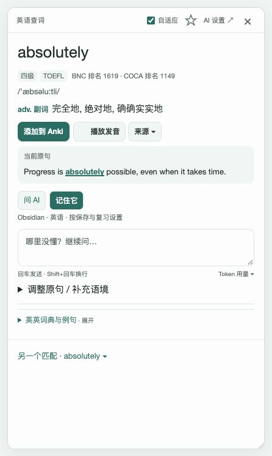
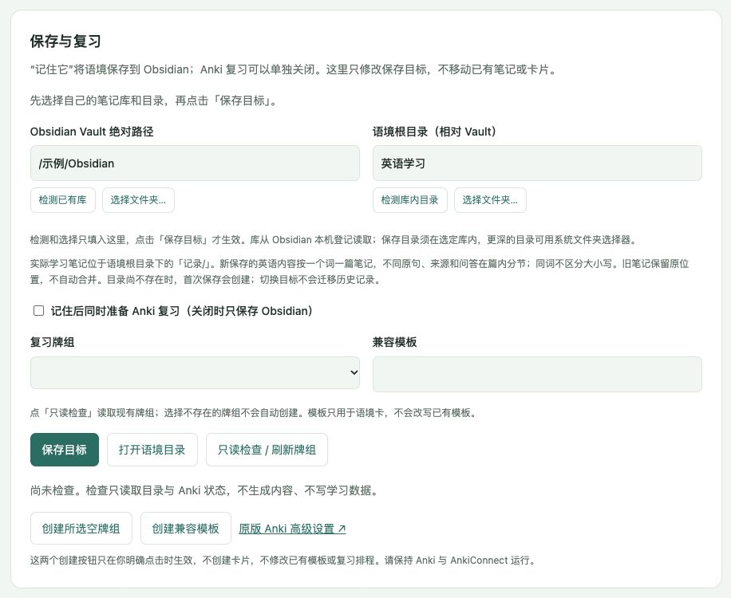

# Yomitan 英汉学习版

**阅读时查懂一句，理解后留下来。**

在原网页上查词、听发音、读英汉释义；需要深入时，在同一张词卡里继续问 AI。点击「记住它」，把这次学习留在 Obsidian，再按需要安排少量 Anki 复习。

基于 [Yomitan](https://github.com/yomidevs/yomitan) 的个人定制版，以中文界面和英语学习为主，不是官方发行版。

**[下载 study8 体验版](https://github.com/suifracti/yomitan/releases/tag/v2026.10.16-zh-study8)** · [安装](#安装) · [日常使用](#日常使用) · [笔记保存到哪里](#笔记保存到哪里)



_当前源码组件的浏览器截图，使用内置真实词条与演示句；不是概念设计图，也没有展示虚构的 AI 回答。_

## 能做什么

- **就地查词**：默认只查当前单词；想查短语时，主动选中整段。原句和来源一起保留。
- **一张卡继续学**：词头、读音、中文词性与释义在前，Wiktionary 英英释义和例句可展开。查解释里的词会打开小卡，不替换父问题与草稿。
- **有需要再问 AI**：解释这里的意思、翻译原句、连续追问；也可只翻译当前一组词典英文。不会因为鼠标经过就生成回答。
- **「记住它」**：保存本次完整已完成问答到 Obsidian。Anki 可以关闭；开启时，按现有规则关联旧卡，或新增必要的 0～1 张卡。
- **一词一篇笔记**：新保存的同一个词归入同一篇 Markdown，不同原句、含义、来源和问答在篇内分节，重复保存不重复追加。
- **轻量收藏**：右上角 ☆ 仅收藏到扩展本地，方便稍后处理，不等于已保存笔记或制卡。

## 安装

### 1. 先装 Chrome 扩展

从 [发行页](https://github.com/suifracti/yomitan/releases/tag/v2026.10.16-zh-study8) 下载 **`yomitan-chrome.zip`** 并解压。不要下载页面底部自动生成的「Source code」来加载。

1. 在 Chrome 打开 `chrome://extensions`，开启「开发者模式」。
2. 点「加载已解压的扩展程序」，选择解压后**包含 `manifest.json` 的目录**。
3. 打开扩展设置或入门页，等待自带 ECDICT / Wiktionary 词典导入完成。首次导入较大，请留出磁盘空间，不要中途关闭页面。

只查词不需要 AI 服务或 Anki。已有自定义词典和停用选择会保留；不要同时启用另一个 Yomitan，以免重复弹窗。

> **已经在用这个定制版？** 保留原加载目录、扩展数据和词典；将新包内容更新到原目录后，在扩展页重新加载一次，再刷新需要查词的网页。不要先卸载，也不必重新导入已有可用词典。

### 2. 想用 AI 或保存到 Obsidian，再装 Mac 本机服务

本轮提供 **macOS + Chrome** 的本机服务包；不提供 Windows / Linux 的 AI 与保存安装器。

需要 **Python 3.11+、Codex CLI 0.162+**；使用 AI 还需要有效的账号登录与可用额度。Codex 安装和账号由你自己准备，安装器不会代购、充值或自动登录。

1. 下载 **`yomitan-local-bridge-macos.zip`** 并解压。
2. 运行其中 `local-bridge/安装本机翻译桥.command`，按终端提示完成。
3. 若提示找不到 Codex，在解压后的目录打开终端，运行下面的命令并替换实际路径：

   ```sh
   python3 local-bridge/install_bridge.py --codex '/绝对路径/codex'
   ```

4. 首次使用时，同意扩展请求的本机通信权限。如果安装器提示尚未登录，按它打印的登录命令处理。
5. 在词卡右上角打开 **AI 设置 → 保存与复习**，选择自己的 Obsidian 库和保存目录，点「保存目标」。模型与推理强度也在这一页选择。

安装服务只为本机通信提供接头；AI 仍需要联网并消耗你的账号额度，不是免费或离线模型。

### 3. Anki 是可选项

**只想记笔记：关闭「记住后同时准备 Anki 复习」即可。** 这种情况下只保存 Obsidian，不调用 AI 择卡。

想用 Anki 时：

1. 打开 Anki Desktop，安装并启用 AnkiConnect。
2. 将 AnkiConnect 配置里的 **`apiPort` 设为 `8766`**，然后重启 Anki。本定制版的保存服务使用这个端口，不是常见的 `8765`。
3. 在「保存与复习」中点「只读检查 / 刷新牌组」，选择目标牌组。
4. 缺少牌组或兼容模板时，分别点击对应创建按钮。没有点击就不会自动创建；已有模板和复习排程不会因此被改写。

高级字段映射仍在原版 Anki 设置里，不需要再配一套复杂表单。

## 日常使用

1. **查**：按住扫描修饰键（默认 Shift）移动到英文单词；也可先选中文字再按扫描键。扫描键可以在原版设置里调整。
2. **看**：先看词典与当前原句。`adv. 副词`、`n. 名词` 等会同时显示中文，不用背缩写。
3. **问**：点击「问 AI」，或在输入框继续提问。回车发送，Shift + 回车换行。原句不完整时，可展开「调整原句 / 补充语境」。
4. **留**：觉得值得保留，再点「记住它」。看不懂词典里的另一个词，可以选中后按扫描键，在次级小卡里查看。
5. **关**：用 × 或 Esc 关闭；误收起后，无新选区时再按扫描键可恢复刚才的卡。卡内有新选区时优先查选中的内容。

### 三个保存动作不要混淆

| 入口        | 做什么                                           | 放在哪里                          |
| ----------- | ------------------------------------------------ | --------------------------------- |
| ☆ 收藏      | 暂存当前词、原句与来源                           | 扩展本地，可在 AI 设置页导出 JSON |
| 添加到 Anki | 直接按 Yomitan 当前卡片格式制卡，不保存整段问答  | Anki，使用统一设置的目标牌组      |
| 记住它      | 保存完整已完成学习，再按开关决定是否安排必要复习 | Obsidian；Anki 可选               |

**Anki 关闭时，不提供上方直接制卡。** Anki 开启后的「正常零张卡」也是完成；断连、择卡失败或缺少模板则是待补齐，不会伪装成零卡成功，已经保存的笔记也不会因此丢失。

## 笔记保存到哪里



_设置页的浏览器截图；路径为演示值，未使用个人配置，也未执行保存。_

在 **AI 设置 → 保存与复习** 中，可以检测已有 Obsidian 库、检测库内目录，也可以用系统文件夹选择器自己选。检测和选择只填入输入框，点击「保存目标」才生效。

例如把语境根目录选为「英语学习」，新笔记就写入：

```text
你的 Obsidian 库/
└── 英语学习/
    └── 记录/
        ├── absolutely--w〈稳定标识〉.md
        └── change--w〈稳定标识〉.md
```

不管目录里原本有多少子文件夹，都不会随意往它们里面分散保存；程序只使用所选根目录下的 **`记录/`**。

- `change` 在不同文章、不同句子里出现，保存在同一词文档内的不同语境分节。
- 不区分大小写；不同词面不额外用 AI 强行合并。每个语境仍有独立身份和卡片关联。
- 重复点保存会去重，新问答追加到对应语境；不会拿新解释覆盖另一句的旧理解。
- 旧版本的分散笔记保留原位置，不会自动搬动或合并。换库、换目录也不会迁移历史；旧待补齐记录仍保留原目标。

**Obsidian 和 Anki 不做相互删除。** 删除扩展不会删除 Vault 中的笔记或 Anki 卡片，但扩展本地缓存与收藏可能丢失，请先导出重要收藏。删掉笔记或卡片后不会自动从另一端完整恢复；重要数据仍应使用你自己的备份。

## 网页视频怎么用

网页上的字幕只要是可读取的文字，Yomitan 就有机会查词；**查到单词不等于拿到了可靠的字幕来源和时间**。

需要字幕轨道、台词时间、回到原句或视频音频/截图时，配合 [本项目的 asbplayer 定制版](https://github.com/suifracti/asbplayer)。没有可用轨道时，可以使用有权限的 SRT/VTT 文件。字幕没有接入可靠来源时，词卡会说明原因，不把普通评论冒充视频台词。

本发行包只包含 Yomitan 和它的 Mac 本机服务；**不包含 asbplayer 或 IINA 插件**，也不保证任意网站、烧录字幕或视频画面都能自动识别。不提供自动 OCR / 转写整片视频。

## 数据与费用

词典查询在本机进行；发音视所选来源可能访问在线服务。AI 只在你明确发起相关操作时使用，可能发送当前词句、补充语境、词典片段，以及该操作选取的相关旧学习摘要或卡片证据；不会默认上传整个网页、Vault、Anki 集合或后台扫描聊天。

本机账号凭据、保存路径配置、个人词典、缓存和学习记录不放进发行包。随包的 ECDICT / Wiktionary 是有来源和许可证的公开词典资源，不是个人学习数据。AI 解释可能出错，保留原词典内容便于核对；可用模型、额度和费用以你的账号为准。

## 常见问题

**有释义，为什么不能问 AI 或保存？** 词典和本机服务是两部分。先确认已安装本机服务、Codex 登录可用，并选择了可用的 Obsidian 库。只读连接检查不调用模型、不创建学习记录。

**Anki 没开、没有这个牌组，或者后来删掉卡片了？** 笔记成功保存后仍保留；Anki 未完成的部分会提示待处理，不会偷偷创建或覆盖旧卡。已显示成功的旧卡被你后来删除，不代表程序会实时检测并自动重建。

**词典为什么有些没有中文、例句或发音？** 覆盖取决于原词典和发音来源。「翻译本组英文」只处理当前组，不会一次翻完整本词库。

**现阶段还有什么限制？** 这是个人维护的体验版，以 Chrome / macOS 为主要使用环境；未承诺所有网站、首次大词库导入和每种账号组合都已完整实测。新保存方式保留每篇 2MB 的上限，超限会明确报错，不静默拆篇或丢内容。

## 开源与致谢

本项目基于 [yomidevs/yomitan](https://github.com/yomidevs/yomitan)，保留原作者版权及 [GPL-3.0-or-later 许可证](LICENSE)。不是 Yomitan 官方发布，不向官方商店自动发布。对应源码就在本仓库；发行包版本与提交见各次 Release 的 `BUILD-INFO.json`。

- [ECDICT](https://github.com/skywind3000/ECDICT)：[MIT 许可证](ext/data/study/ECDICT-LICENSE.txt)。
- English Wiktionary / Kaikki / WTY：词典数据遵循 CC BY-SA 4.0，完整来源、贡献者与许可见 [WTY-SOURCE](ext/data/study/WTY-SOURCE.md)。
- 截图使用当前组件的隔离演示，不包含真实账号、笔记或模型生成结果。

开发者可查看 [构建说明](docs/personal-build.md)；AI 接手路由另见 [AGENTS.md](AGENTS.md)，不影响普通使用者按上面的步骤安装。
